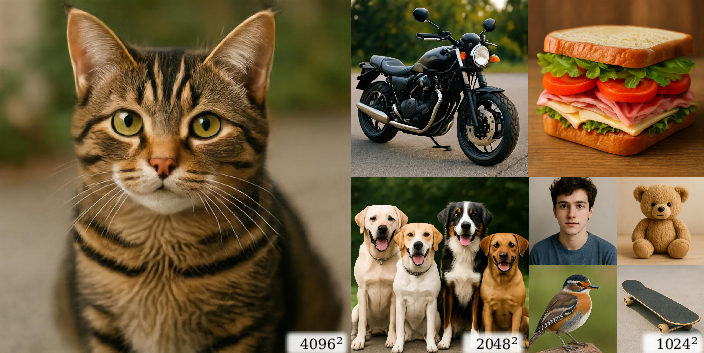
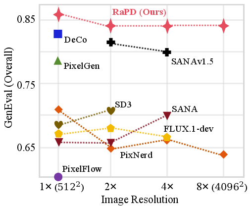

<h1 align="center">RaPD: Resolution-Agnostic Pixel Diffusion<br>via Semantics-Enriched Implicit Representations</h1>

<p align="center"><strong>NeurIPS 2026</strong></p>

<p align="center">
  <a href="https://scholar.google.com/citations?user=h6tuBAcAAAAJ&amp;hl=zh-CN">Yanhao Ge</a><sup>1</sup> ·
  <a href="https://syguan96.github.io/">Shanyan Guan</a><sup>2</sup> ·
  <a href="https://tjmyyou.github.io/wwh.html">Weihao Wang</a><sup>1,2</sup> ·
  <a href="https://tyshiwo.github.io/">Ying Tai</a><sup>3</sup> ·
  <a href="https://tjmyyou.github.io/index.html">Mingyu You</a><sup>1,4</sup>
</p>

<p align="center">
  <sup>1</sup>Tongji University · <sup>2</sup>vivo Mobile Communication Co., Ltd. · <sup>3</sup>Nanjing University<br>
  <sup>4</sup>State Key Laboratory of Autonomous Intelligent Unmanned Systems;<br>
  Frontiers Science Center for Intelligent Autonomous Systems, Ministry of Education
</p>

<p align="center">
  <a href="https://arxiv.org/abs/2605.15908"></a>
  <a href="https://wangwhtj.github.io/rapd-page/"></a>
  <a href="https://wangwhtj.github.io/rapd-page/assets/slides_camera_ready.pdf"></a>
  <a href="https://huggingface.co/hhaohao/rapd"></a>
</p>

<p align="center">
  
  
</p>

## Overview

RaPD performs diffusion in a continuous **Neural Image Field (NIF)** latent space: one generated representation can be rendered at different output resolutions by changing the query coordinates. It combines **Semantic Representation Guidance (SRG)**, which makes the representation more suitable for generation, with a **Coordinate-Queried Attention Renderer (CQAR)** for coordinate-conditioned, scale-aware rendering.

## Release Status

- [x] Release the SFT T2I model and inference demo.
- [ ] Release training and inference code.

## Installation

```bash
git clone https://github.com/wangwhTj/rapd.git
cd rapd

python3 -m venv rapd
source rapd/bin/activate

# Install PyTorch / torchvision matching your CUDA environment first.
python3 -m pip install -r requirements.txt
```

## Pretrained Models

Place the model files under the project root as follows:

```text
rapd/
└── pretrain_weights/
    ├── ae.pt
    ├── ae_stats_res512.pt
    ├── rapd_sft_512.ckpt
    ├── Qwen3-1.7B/                 # Complete model, configuration, and tokenizer files
    └── torch_hub/
        ├── facebookresearch_dinov2_main/  # Complete DINOv2 source, including hubconf.py
        └── checkpoints/
            └── dinov2_vitb14_pretrain.pth
```

| Component | Purpose | Download |
| --- | --- | --- |
| AE checkpoint (`ae.pt`) | Image encoding and rendering | [Download](https://huggingface.co/hhaohao/rapd/blob/main/ae.pt) |
| AE statistics (`ae_stats_res512.pt`) | Matching statistics at 512 resolution | [Download](https://huggingface.co/hhaohao/rapd/blob/main/ae_stats_res512.pt) |
| Final SFT checkpoint (`rapd_sft_512.ckpt`) | Text-to-image generation | [Download](https://huggingface.co/hhaohao/rapd/blob/main/rapd_sft_512.ckpt) |

Use the AE checkpoint and statistics that match the SFT checkpoint.

Please download Qwen3-1.7B and DINOv2 from their respective official sources. The current inference entry point also initializes DINOv2, so its complete source and weight cache are required. LPIPS weights are only needed for AE training.

## Quick Inference

Run the following commands from the project root after preparing the weights above.

### 1. Full DPG-Bench prompt set

```bash
CUDA_VISIBLE_DEVICES=0 python3 main.py predict \
  -c configs_t2i/inference.yaml
```

Images are saved to `inference_outputs/exp_rapd_sft_512_inference/samples/predict/`.

To test a different output resolution, for example 1024 × 1024:

```bash
CUDA_VISIBLE_DEVICES=0 python3 main.py predict \
  -c configs_t2i/inference.yaml \
  --set model.decode_size=1024 \
  --set trainer.predict_subdir=predict_1024
```

Images are saved to `inference_outputs/exp_rapd_sft_512_inference/samples/predict_1024/`.

### 2. Custom prompt

The example prompt is provided in [`evaluations/custom_prompts/ice_flower.txt`](evaluations/custom_prompts/ice_flower.txt):

> A clear ice cube containing a frozen red flower, placed on a reflective metal tray, cold studio lighting, highly detailed transparency.

```bash
CUDA_VISIBLE_DEVICES=0 python3 main.py predict \
  -c configs_t2i/inference.yaml \
  --set data.pred_dataset.init_args.prompt_path=./evaluations/custom_prompts \
  --set trainer.predict_subdir=custom_prompt
```

The output is saved to `inference_outputs/exp_rapd_sft_512_inference/samples/custom_prompt/ice_flower_42.png`.

## Data Preparation and Training

Run all commands from the project root.

### 1. Prepare the data and model dependencies

Arrange the BLIP3o pretraining tar shards and the BLIP3o-60k image/text pairs as follows:

```text
datasets/BLIP3o/
├── BLIP3o-Pretrain-Long-Caption/*.tar
├── BLIP3o-Pretrain-Short-Caption/*.tar
├── BLIP3o-Pretrain-JourneyDB/*.tar
└── BLIP3o-60k/                 # Images with matching .txt captions
```

Training and inference use `pretrain_weights/` for Qwen3-1.7B and the DINOv2 source/weight cache. AE training also requires LPIPS weights.

### 2. Train the AE

```bash
export CUDA_VISIBLE_DEVICES=0,1,2,3
torchrun --standalone --nproc_per_node=4 scripts/train_cqar_ae_sr.py \
  --train-dir ./datasets/BLIP3o/BLIP3o-Pretrain-Long-Caption \
              ./datasets/BLIP3o/BLIP3o-Pretrain-Short-Caption \
              ./datasets/BLIP3o/BLIP3o-Pretrain-JourneyDB \
  --save-dir ./checkpoints/window_att_ae_sr \
  --inp-size 256 --scale-min 1.0 --scale-max 4.0 \
  --feat-channels 16 --hidden 256 \
  --lr 2e-4 --batch-size 8 --max-steps 10000 \
  --renderer-block-type window_attention \
  --renderer-num-blocks 4 --renderer-num-heads 4 \
  --renderer-ffn-expansion-factor 2.0 --renderer-window-size 8 \
  --vf-dino-weight-path pretrain_weights/torch_hub/checkpoints/dinov2_vitb14_pretrain.pth \
  --vf-dino-repo-dir pretrain_weights/torch_hub/facebookresearch_dinov2_main \
  --vf-loss-weight 0.1
```

The AE checkpoint is saved to `checkpoints/window_att_ae_sr/best.pt`.

### 3. Compute AE statistics

Use the same AE checkpoint for both resolutions.

**256 resolution**

```bash
CUDA_VISIBLE_DEVICES=0 python3 scripts/compute_ae_stats.py \
  --ckpt ./checkpoints/window_att_ae_sr/best.pt \
  --data-dir ./datasets/BLIP3o/BLIP3o-Pretrain-Long-Caption \
             ./datasets/BLIP3o/BLIP3o-Pretrain-Short-Caption \
             ./datasets/BLIP3o/BLIP3o-Pretrain-JourneyDB \
  --webdataset --ae-type cqar_ae --feat-channels 16 \
  --resolution 256 --batch-size 32 --num-workers 8 --num-samples 50000 \
  --preprocess crop_resize \
  --out ./checkpoints/window_att_ae_sr/ae_stats.pt
```

**512 resolution**

```bash
CUDA_VISIBLE_DEVICES=0 python3 scripts/compute_ae_stats.py \
  --ckpt ./checkpoints/window_att_ae_sr/best.pt \
  --data-dir ./datasets/BLIP3o/BLIP3o-Pretrain-Long-Caption \
             ./datasets/BLIP3o/BLIP3o-Pretrain-Short-Caption \
             ./datasets/BLIP3o/BLIP3o-Pretrain-JourneyDB \
  --webdataset --ae-type cqar_ae --feat-channels 16 \
  --resolution 512 --batch-size 16 --num-workers 8 --num-samples 50000 \
  --preprocess crop_resize \
  --out ./checkpoints/window_att_ae_sr/ae_stats_res512.pt
```

### 4. Train the text-to-image model

Run the following stages in order on 8 GPUs. The configurations load the preceding stage's checkpoint automatically.

**256 pretraining**

```bash
CUDA_VISIBLE_DEVICES=0,1,2,3,4,5,6,7 torchrun --standalone --nproc_per_node=8 main.py fit \
  -c configs_t2i/rapd_pretrain_256.yaml
```

**512 pretraining**

```bash
CUDA_VISIBLE_DEVICES=0,1,2,3,4,5,6,7 torchrun --standalone --nproc_per_node=8 main.py fit \
  -c configs_t2i/rapd_pretrain_512.yaml
```

**512 SFT**

```bash
CUDA_VISIBLE_DEVICES=0,1,2,3,4,5,6,7 torchrun --standalone --nproc_per_node=8 main.py fit \
  -c configs_t2i/rapd_sft_512.yaml
```

The final checkpoint is saved to `rapd_work_dir/exp_rapd_sft_512/epoch=0-step=460000.ckpt`.

## Citation

If you find this work useful, please cite our paper:

```bibtex
@article{ge2026rapd,
  title={RaPD: Resolution-Agnostic Pixel Diffusion via Semantics-Enriched Implicit Representations},
  author={Ge, Yanhao and Guan, Shanyan and Wang, Weihao and Tai, Ying and You, Mingyu},
  journal={arXiv preprint arXiv:2605.15908},
  year={2026}
}
```

The citation above follows the project page’s current BibTeX entry.

## License

The code is provided for non-commercial research purposes only. Commercial use is not permitted.
Model weights will be released under a separately specified license.
Third-party models and datasets are subject to their respective licenses.

## Acknowledgements

This project is built upon the excellent [PixelGen](https://github.com/Zehong-Ma/PixelGen), [JiT](https://github.com/LTH14/JiT), and [INFD](https://github.com/yinboc/infd) projects. We sincerely thank their authors for their inspiring work and open-source contributions.
